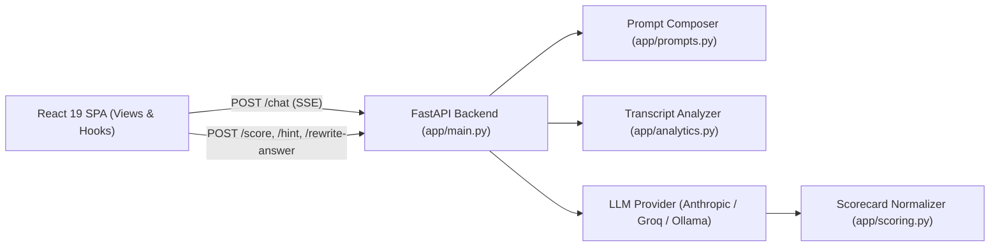

# PrepCoach Architecture & Calibration Design

## System Overview

PrepCoach uses a stateless FastAPI backend paired with a React 19 SPA frontend. All conversational state is held client-side during an active interview session and persisted in `localStorage` upon scorecard generation.

## Interview Cadence Loop

To prevent the LLM from drifting into generic chat or prematurely coaching the candidate, `app/prompts.py` enforces a strict 3-step loop:
1. **Initial Question**: The interviewer asks exactly one direct question (1–3 sentences) with zero preamble.
2. **Probing Follow-Up**: When the candidate responds, the interviewer probes the weakest, vaguest, or least-supported claim in their answer.
3. **Structured Checkpoint Feedback + Next Question**: After the follow-up is answered, the interviewer outputs a structured feedback block (`**Strengths:**`, `**Gaps:**`, `**Stronger answer:**`) which `frontend/src/lib/feedback.js` parses into a distinct visual evaluation card before displaying the next question.

## Anti-Inflation Scoring & Server-Side Normalization

LLMs naturally cluster evaluation scores around `75–85`. PrepCoach counteracts score inflation via:
1. **Explicit Calibration Anchors**:
   - `40–55`: Typical new-grad answer with real gaps
   - `56–70`: Solid and hireable
   - `71–85`: Genuinely strong; requires explicit transcript evidence
   - `86+`: Exceptional; awarded almost never
2. **Pinned Role Dimensions**: Each role defines four verbatim dimension names so retakes can compute exact per-dimension deltas (`prevScorecard` vs `scorecard`).
3. **Deterministic Server-Side Band Derivation**: `app/scoring.py` clamps all scores to `0–100`, re-derives `band` (`Needs Work`, `Fair`, `Strong`, `Excellent`) so the label never contradicts the numeric score, and identifies `strongest_dimension` and `weakest_dimension`.
4. **Objective Communication Analytics**: `app/analytics.py` analyzes candidate turns for word count, filler frequency, quantified metrics, and trade-off reasoning markers.
